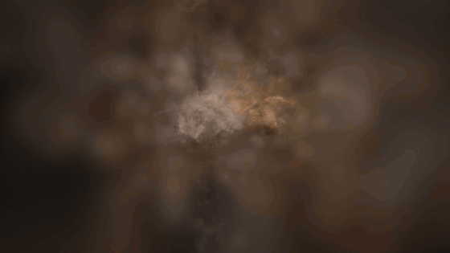
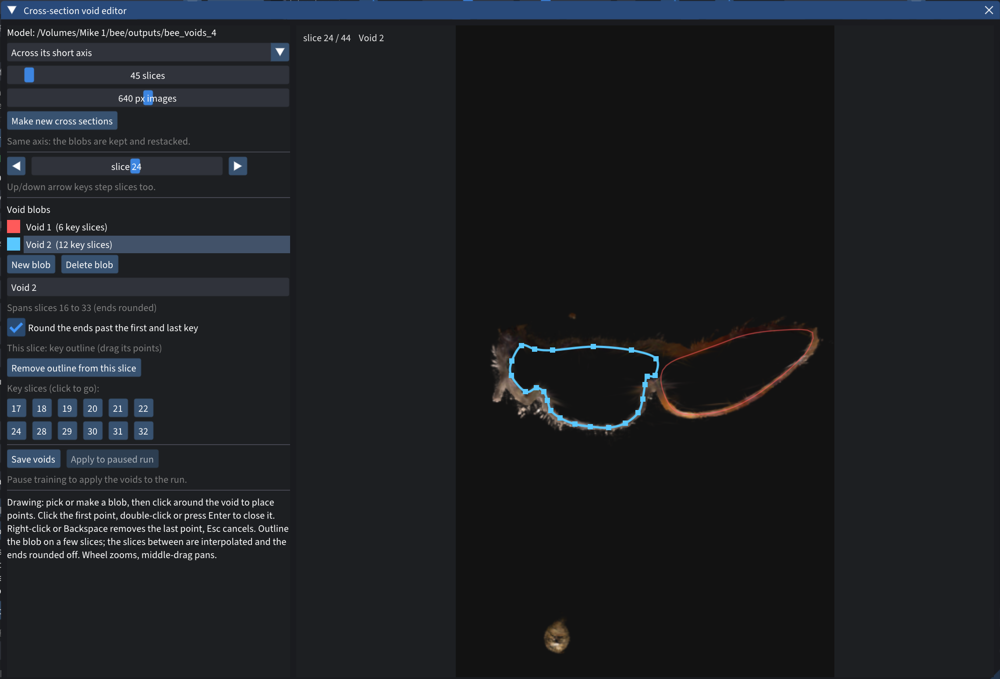

# Spirula Studio add-ons

Two add-ons for [Spirula Studio](https://github.com/harry7557558/spirula-studio),
the Gaussian splat trainer, made while scanning pinned insects with a macro
camera rig. Each one installs on its own; pick one, or both.

| Add-on | What it does | Guide |
|---|---|---|
| **Training animation capture** | Records the model while it trains, from training views, an arc, or an orbit, as PNG frames or H.264/H.265 video. | [Install and how to use](training-capture/) |
| **Insect voids** | Lets you draw voids inside a shiny body on cross sections of the model, so reflections can't be built as structure inside it, and the shell trains solid. | [Install and how to use](insect-voids/) |



*An arc capture of a bee training from scratch ([1080p video](media/training-capture-arc-1080p.mp4)).*



*The insect voids editor: voids drawn on a cross section of a bee.*

## Install in short (macOS)

Each add-on's guide has the full steps, with screenshots of how to use it.

```bash
xcode-select --install
brew install git cmake ninja libomp ffmpeg

git clone -b insect-tools https://github.com/timfennell/spirula-studio
cd spirula-studio
bash build_develop.bash -DSS_BACKEND=vulkan
cmake --build build --target macos_app      # makes build/Spirula Studio.app
```

Which branch to clone:

| Branch | Contains |
|---|---|
| `insect-tools` | both add-ons |
| `training-capture` | Training animation capture only |
| `insect-voids` | Insect voids only |

Linux and Windows: clone the same branch and follow Spirula's
[build guide](https://github.com/harry7557558/spirula-studio/blob/master/docs/build.md).

### Or patch your own clone

The add-ons are also plain source patches. They're made against upstream
`master` at
[`d6d0d855`](https://github.com/harry7557558/spirula-studio/commit/d6d0d855)
(2026-10-14). Apply **one** of them:

```bash
# Training animation capture only
curl -L https://raw.githubusercontent.com/timfennell/spirula-addons/main/training-capture/training-capture.patch | git am -3

# Insect voids only
curl -L https://raw.githubusercontent.com/timfennell/spirula-addons/main/insect-voids/insect-voids.patch | git am -3

# Both
curl -L https://raw.githubusercontent.com/timfennell/spirula-addons/main/both/insect-tools-both.patch | git am -3
```

Use the **Both** patch if you want both add-ons. The two single patches touch
the same few lines of the trainer screen, so they don't stack on each other.
On newer versions of Spirula the patches usually still apply. If one doesn't,
please open an issue.

## Tested on

macOS 26 on an Apple M2 Pro (16 GB), Vulkan backend via MoltenVK, against
Spirula `d6d0d855`: each version compiles, and the combined build was used to
train with voids and capture video. *Voids block light* is Vulkan only; on
CUDA builds it switches itself off and says so in the log.

## License

GPL-3.0, the same as Spirula Studio.
