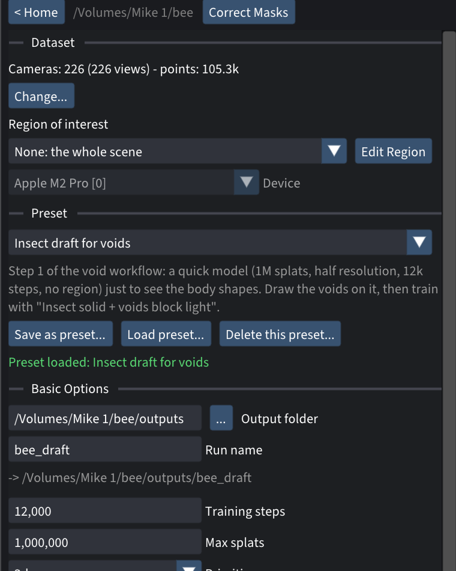
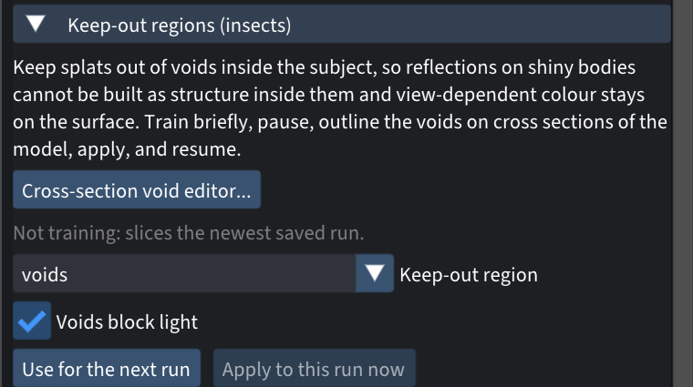
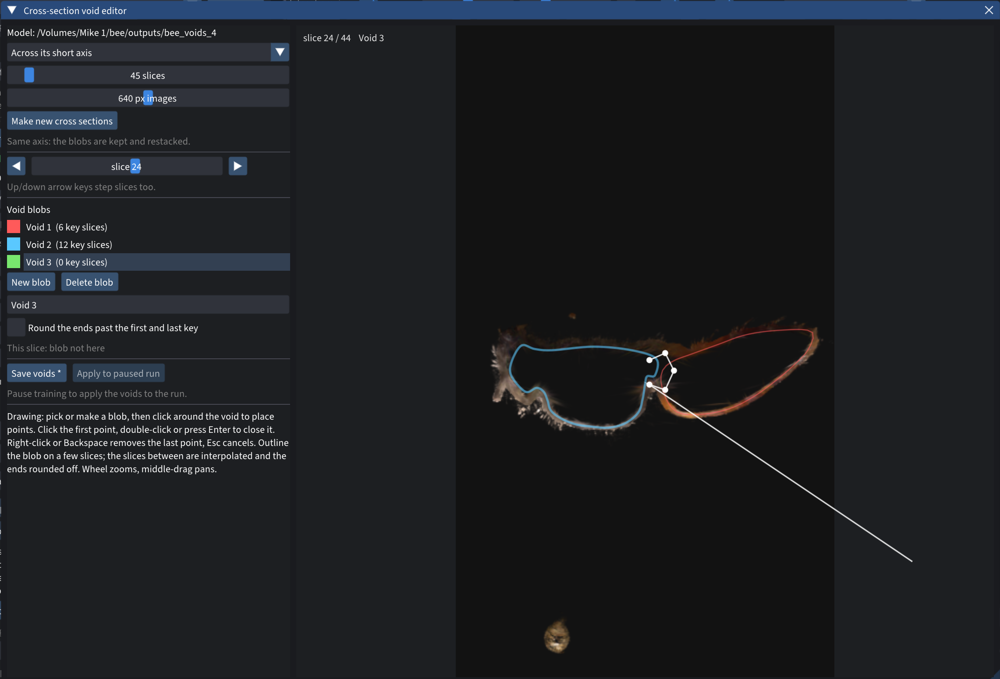
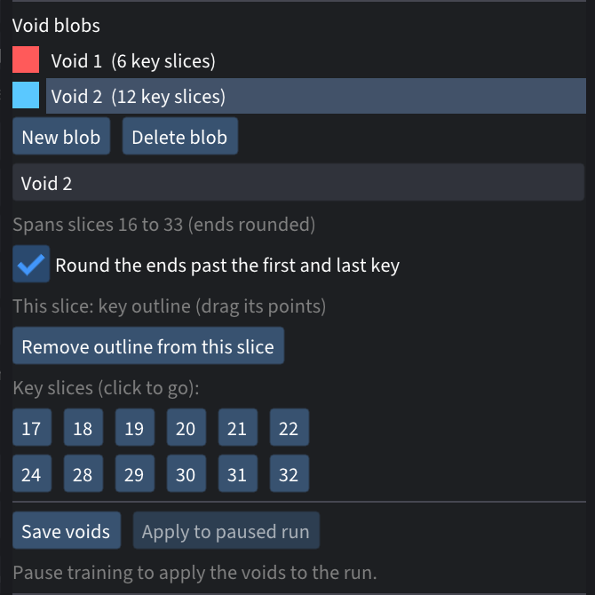

# Insect voids

For shiny subjects: insects, beetles, anything with a glossy, curved shell.


## The problem

A curved glossy surface mirrors its lights as a virtual image *behind* the
surface. Plain 3D Gaussian splatting reproduces that literally: it builds a
cloud of bright splats **inside** the body, and leaves the shell
half-transparent so you see them through it. Cut such a model open and the
inside is full of junk. Look at one wall face-on and you can see through it.

## What this add-on does

- **Cross-section void editor:** cuts your model into slices so you can draw
  where the inside should be empty.
- **Keep-out:** while training, splats inside the voids fade away.
- **Voids block light:** while training, each camera ray stops where it
  enters a void. The shell can no longer lean on the wall behind it, so it
  has to become solid by itself, and the shine ends up on its outer surface,
  where it belongs.


*Left: 400 training steps without Voids block light; the checkerboard shows
through the back wall. Right: the same 400 steps with it; the wall is solid.*

---

## Install

You build Spirula Studio from source with the add-on included. These steps are
for macOS. For Linux and Windows, see the note at the end.

**1. Install the tools** (once). In Terminal:

```bash
xcode-select --install
```

Then install [Homebrew](https://brew.sh) if you don't have it, and:

```bash
brew install git cmake ninja libomp
```

**2. Get Spirula with the add-on:**

```bash
git clone -b insect-voids https://github.com/timfennell/spirula-studio
cd spirula-studio
```

For both add-ons, use `-b insect-tools` instead.

**3. Build it.** The first build downloads its own Vulkan driver (MoltenVK) and
shader compiler, then compiles; expect 30–60 minutes.

```bash
bash build_develop.bash -DSS_BACKEND=vulkan
```

**4. Make the app:**

```bash
cmake --build build --target macos_app
```

This creates `build/Spirula Studio.app`. Drag it into Applications. Rename it,
for example "Spirula Studio (add-ons)", if you want to keep the official app
too.

**5. Get the presets** (optional): download the two `.json` files in
[`presets/`](presets/). You load one by dropping it onto the Spirula window.

**If the build stops with errors about missing C++ headers** (seen with some
Apple clang versions), run this in the same Terminal window and repeat step 3:

```bash
export CXXFLAGS="-nostdinc++ -isystem $(xcrun --show-sdk-path)/usr/include/c++/v1"
```

**Already have your own Spirula clone?** Apply the add-on as a patch instead
of cloning:

```bash
curl -L https://raw.githubusercontent.com/timfennell/spirula-addons/main/insect-voids/insect-voids.patch | git am -3
```

**Linux and Windows:** clone the same branch, then follow Spirula's
[build guide](https://github.com/harry7557558/spirula-studio/blob/master/docs/build.md)
(you'll need the Vulkan SDK). Voids block light needs the Vulkan backend.

---

## How to use it

The idea: train a quick draft to see the body's shape, draw the voids on it,
then train the real model with the voids from the very first step.

### 1. Train a quick draft

Open your dataset and drop
[`insect-draft-for-voids.json`](presets/insect-draft-for-voids.json) onto the
window. That's about 1M splats, half resolution and 12,000 steps; well under
an hour on a recent Mac. Set **Region of interest** to **None: the whole
scene** (dropping a preset doesn't change it), then press **Start Training**.



### 2. Open the void editor

When the draft is done, expand **Keep-out regions (insects)** and click
**Cross-section void editor...**. When nothing is training, it slices the
newest saved run.



In the editor:

- **Axis:** choose how to slice. *Across its short axis* usually works best
  for an insect.
- **Slices:** choose how many. 45 is a good start. You can recut later at
  finer spacing; along the same axis your blobs are kept.
- **Moving between slices:** use the slider, the arrows, or the up/down keys.

### 3. Draw the voids

Click **New blob**, then click around the inside of the body to place points.
Click the first point again, double-click, or press Enter to close the
outline. The line follows your mouse while you draw.



- **Keep it inside the shell.** Bring the outline right up to the inside of
  the shell, but leave a hair's width for the wall itself. Under fur, follow
  the skin (the cuticle), not the base of the hair.
- **Key slices.** Draw the blob on a few slices along its length, more where
  the body bends. Slices in between are filled in for you. Each slice you draw
  on becomes a **key slice**; click its number to jump back to it, and drag
  points to adjust.
- **Several voids.** Make one blob per hollow part, for example the thorax and
  the abdomen. Separate blobs never merge.
- **Ends.** A blob ends at its first and last key slice. Tick **Round the
  ends** to let it taper a little past them.
- **Undoing.** Right-click or Backspace removes the last point. Esc cancels
  the outline you're drawing.



When you're done, click **Save voids**. This writes `roi/voids.json` and
`roi/voids.svoid` in your dataset folder.

### 4. Train the real model with the voids

Drop [`insect-solid-voids-block-light.json`](presets/insect-solid-voids-block-light.json)
onto the window, or use your own settings. Then, in **Keep-out regions
(insects)**:

1. Choose **voids** as the keep-out region.
2. Make sure **Voids block light** is ticked.
3. Click **Use for the next run**.
4. Press **Start Training**.

### 5. Check the result

In your viewer, cut the finished model in half and look at one wall face-on.
It should be solid, with an empty inside.

---

## Good to know

- **Reusing voids:** they're saved in the dataset's own coordinates, so every
  later run on the same dataset reuses them. Redraw them only if you solve the
  cameras again.
- **Adding voids to a paused run:** use **Apply to paused run** in the editor.
  Splats inside the voids only fade while training is still placing splats
  (densification), so drawing the voids before the real run works best.
- **Requirements:** Voids block light needs the Vulkan backend, the `3dgs` or
  `mip` primitive, and pinhole cameras (lens distortion is fine). Otherwise
  Spirula says so in the log and trains without it. The rest works anywhere.
- **Speed:** about 2% slower per training step on a 5M-splat run.
- **Checking alignment:** set `SS_VOID_STOP_DUMP=<folder>` before starting
  Spirula. It then writes the void map it casts for each camera, which you can
  lay over the photos.
- **Also fixed:** Spirula's region list now skips macOS `._` files. On drives
  that aren't Mac-formatted (exFAT, NTFS), they used to break loading the
  dataset.

## What the patch changes

`src/app/gui/VoidSlices.*`, `VoidEditor.*`, `KeepOutPanel.cpp` (editor and
panel), `src/data/RegionRaycast.*` (casting camera rays against the voids),
`src/backend/api/VoidStop.h` and the Vulkan 2D raster shader (stopping rays),
the engine's training step, the `--roi-void-stop` option with translations in
all 13 languages, and `docs/notes/insect-voids.md`.
