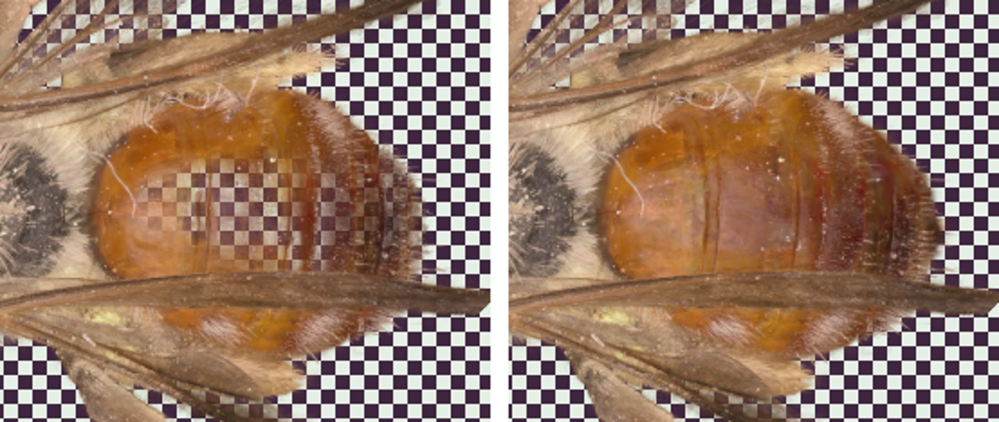

# Insect voids

For shiny subjects: insects, beetles, anything with a glossy convex shell.

## The problem

A curved glossy surface mirrors its lights as a virtual image *behind* the
surface. Plain 3D Gaussian splatting reproduces that literally: it builds a
cloud of bright splats **inside** the body, and leaves the shell
half-transparent so you see them through it. Cut such a model open and the
inside is full of junk. Look at one wall face-on and you can see through it.

## What this add-on does

1. **Cross-section void editor.** It cuts your model into slices along the
   body. On a few key slices you draw a blob outline wherever the inside should
   be empty, as many blobs as you need. Outlines between key slices are filled
   in for you.
2. **Keep-out.** While training, splats inside the voids fade away.
3. **Voids block light.** While training, each camera ray stops where it
   enters a void. The shell can no longer lean on the wall behind it, so it
   has to become solid by itself, and the shine ends up on its outer surface
   as view-dependent colour (SH), where it belongs.

*Left: 400 training steps without Voids block light; the checkerboard shows
through the back wall. Right: the same 400 steps with it; the wall is solid.*

## Workflow

1. **Draft for shapes.** Train a quick model only to see the body's outline:
   about 1M splats, half resolution, 10–15k steps, no region. The
   [draft preset](presets/insect-draft-for-voids.json) does this.
2. **Draw the voids.** On the trainer screen, open **Keep-out regions
   (insects) → Cross-section void editor**. With nothing training, it slices
   the newest saved run.
   - Pick an axis and a number of slices. You can recut later along the same
     axis at finer spacing without losing your blobs.
   - Add a blob for each void and draw its outline on a few key slices, more
     where the body bends.
   - Bring every outline right up to the inside of the shell. Under fur that
     means the cuticle, not the base of the hair. Leave a hair's width for the
     wall itself.
   - Click **Save voids**. This writes `roi/voids.json` (the region) and
     `roi/voids.svoid` (your drawing) in the dataset.
3. **Train for real** with the voids from the first step. Either use
   [the full preset](presets/insect-solid-voids-block-light.json), or pick the
   voids in **Keep-out regions**, keep **Voids block light** ticked, and click
   **Use for the next run**.
4. **Check.** Cut the exported model in half in a viewer and look at one wall
   face-on. It should be solid.

To load a preset, drop its JSON file onto the Spirula window.

The voids are saved in the dataset's own coordinates, so every later run on
the same dataset reuses them. Redraw them only if you solve the cameras again.

You can also apply voids to a paused run (**Apply to paused run**), but
splats inside them only fade while splat placement (densification) is still
running. Drawing the voids before the real run works best.

## Requirements

- **Voids block light** needs the Vulkan backend, the `3dgs` or `mip`
  primitive, and pinhole cameras (lens distortion is fine). Otherwise the
  trainer logs why and trains without it. The rest works anywhere.
- About 2% slower per training step on a 5M-splat run.
- To check that the voids line up with your photos, set
  `SS_VOID_STOP_DUMP=<folder>`. Spirula then writes the void map it casts for
  each camera.

## Also fixed

Spirula's region list now skips macOS `._` files. On drives that aren't
Mac-formatted (exFAT, NTFS), they used to break loading the dataset.

## Files the patch adds or changes

`src/app/gui/VoidSlices.*`, `VoidEditor.*`, `KeepOutPanel.cpp` (editor and
panel), `src/data/RegionRaycast.*` (casting camera rays against the voids),
`src/backend/api/VoidStop.h` and the Vulkan 2D raster shader (stopping rays),
the engine's training step, the `--roi-void-stop` option with translations in
all 13 languages, and `docs/notes/insect-voids.md`.
