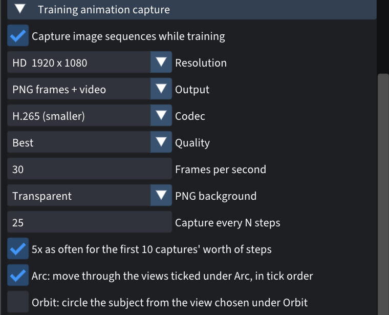
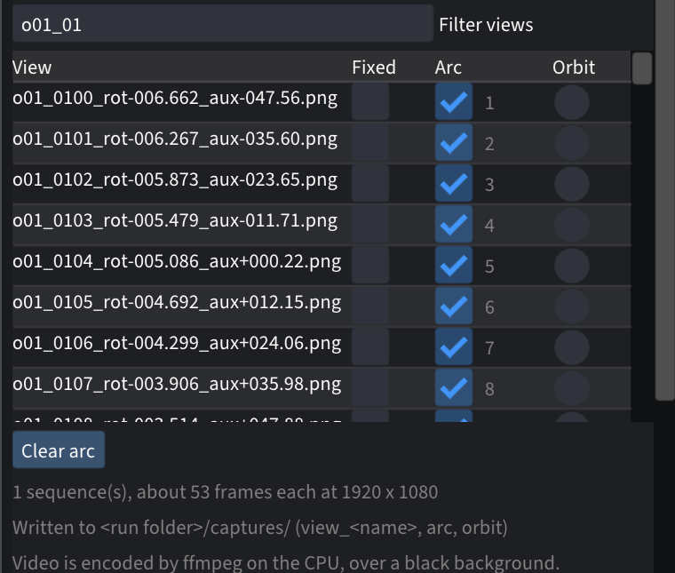
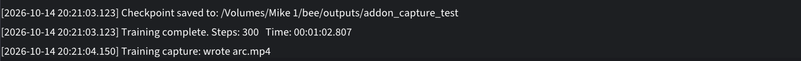

# Training animation capture

Records the model while it trains. The frames come from cameras of their own,
so the live preview stays free and you can keep working.


*An arc through 14 training views while a bee trains from scratch
([1080p video](../media/training-capture-arc-1080p.mp4)).*

---

## Install

You build Spirula Studio from source with the add-on included. These steps are
for macOS. For Linux and Windows, see the note at the end.

**1. Install the tools** (once). In Terminal:

```bash
xcode-select --install
```

Then install [Homebrew](https://brew.sh) if you don't have it, and:

```bash
brew install git cmake ninja libomp ffmpeg
```

`ffmpeg` is only needed for video output; PNG frames work without it.

**2. Get Spirula with the add-on:**

```bash
git clone -b training-capture https://github.com/timfennell/spirula-studio
cd spirula-studio
```

For both add-ons, use `-b insect-tools` instead.

**3. Build it.** The first build downloads its own Vulkan driver (MoltenVK) and
shader compiler, then compiles; expect 30–60 minutes.

```bash
bash build_develop.bash -DSS_BACKEND=vulkan
```

**4. Make the app:**

```bash
cmake --build build --target macos_app
```

This creates `build/Spirula Studio.app`. Drag it into Applications. Rename it,
for example "Spirula Studio (add-ons)", if you want to keep the official app
too.

**If the build stops with errors about missing C++ headers** (seen with some
Apple clang versions), run this in the same Terminal window and repeat step 3:

```bash
export CXXFLAGS="-nostdinc++ -isystem $(xcrun --show-sdk-path)/usr/include/c++/v1"
```

**Already have your own Spirula clone?** Apply the add-on as a patch instead
of cloning:

```bash
curl -L https://raw.githubusercontent.com/timfennell/spirula-addons/main/training-capture/training-capture.patch | git am -3
```

**Linux and Windows:** clone the same branch, then follow Spirula's
[build guide](https://github.com/harry7557558/spirula-studio/blob/master/docs/build.md)
(you'll need the Vulkan SDK).

---

## How to use it

**1. Open the panel and choose the output.** Open your dataset on the training
screen and expand **Training animation capture**. Tick **Capture image
sequences while training**, then choose:

- **Resolution:** HD, 2K or 4K.
- **Output:** PNG frames, video, or both.
- **Codec and quality:** for video. H.265 gives the smallest files.
- **PNG background:** transparent, or black.
- **Capture every N steps:** how often to take a frame. Tick **5x as often**
  to get extra frames at the start, where the model changes fastest.



**2. Pick the views.** Each row is one of your training photos. Use **Filter
views** to find the ones you want.

- **Fixed:** tick a photo to get its own video from that camera.
- **Arc:** tick **Arc**, then tick two or more photos in the **Arc** column.
  The numbers show the order the camera moves through them.
- **Orbit:** tick **Orbit**, then choose one photo to start from. The camera
  circles the subject from there.

You can use all three at once. The line under the list tells you how many
frames each will get.



**3. Train as usual.** Frames are taken in the background while training
runs, and the arc or orbit moves along with it, ending when training ends. The
log shows when each video is written:



**4. Find the results** in your run's folder, under `captures/`:

```
<run folder>/captures/
    arc/arc.mp4              the video
    arc/frame_00000.png ...  the frames, if you chose PNG
    arc/frames.csv           which training step each frame shows
    view_<photo name>/ ...   one folder per Fixed view
    orbit/ ...
```

Your settings are remembered for the next run.

---

## Good to know

- **Cost:** frames are rendered between training steps by the trainer's own
  renderer, so there's no second copy of the model on the GPU. That's about
  10 MB of extra memory, and about 0.37 s per 4K frame on an M2 Pro. Writing
  PNGs and encoding video run on separate threads.
- **Size:** a 4K H.265 video is about 250 times smaller than the same frames
  as PNGs.
- **Clean edges:** frames show the bare model, without training's random
  background colours, so soft edges like hair and wings come out clean.

## What the patch changes

`src/app/gui/TrainCapture.{h,cpp}` (renderer and writers),
`src/app/gui/TrainCapturePanel.cpp` (the panel), small hooks in `GuiApp` and
`TrainRunner`, and `engine_set_background_enabled` in the engine. Design notes
are in `docs/notes/training-capture.md`.
