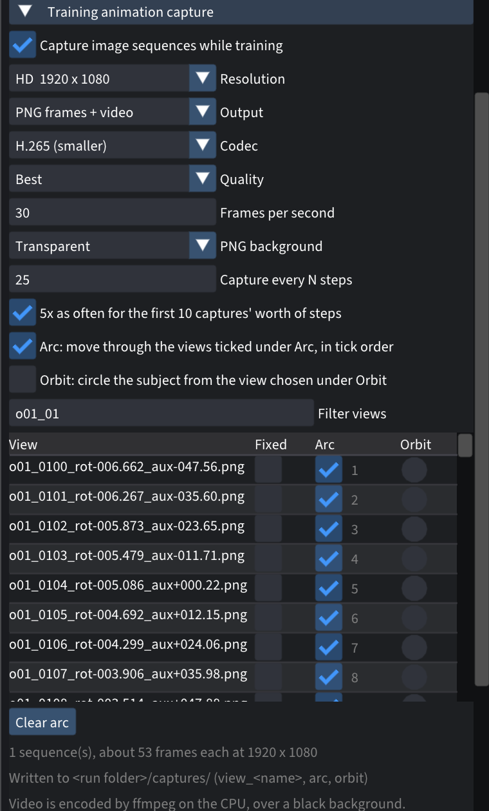

# Training animation capture

Records the model while it trains. The frames come from cameras of their own,
so the live preview stays free and you can keep working.

## What you get

A **Training animation capture** section on the trainer screen with:

- **Tracks**, as many as you like at once:
  - **Fixed views:** one video per training photo you pick, from that camera.
  - **Arc:** a smooth path through two or more training views, in order. It
    keeps looking at the subject.
  - **Orbit:** a turn around the scene, starting from one training view.
- **Resolution:** HD, 2K or 4K.
- **Output:** PNG frames (transparent, or over black), a video, or both.
  Video is H.264 or H.265 through ffmpeg, at three quality levels. A 4K H.265
  sequence is about 250 times smaller than its PNGs.
- **Schedule:** a frame every N steps, five times as often at the start, where
  the model changes fastest. The motion is spread over the whole run, so an
  arc or orbit finishes when training does.

Frames go to `<run folder>/captures/<track>/`, with a `frames.csv` listing
which training step each frame shows.

*The panel, set up for an arc through fourteen training views.*

## Cost

Frames render on the training thread between steps, through the trainer's own
renderer. There's no second copy of the model on the GPU: about 10 MB of
extra memory, and about 0.37 s per 4K frame on an M2 Pro. Writing PNGs and
encoding run on separate threads.

## Install

See [Installing](../README.md#installing). Video output needs `ffmpeg` on your
PATH (or set in Spirula's tool paths).

## Files the patch adds or changes

`src/app/gui/TrainCapture.{h,cpp}` (renderer and writers),
`src/app/gui/TrainCapturePanel.cpp` (the panel), small hooks in `GuiApp` and
`TrainRunner`, and `engine_set_background_enabled` in the engine, so frames
show the bare splats rather than training's random background. Design notes
are in `docs/notes/training-capture.md`.
